<!-- Generated by build/Templates/CategoryReport.cshtml. Do not edit this file directly. -->

[← .NET Matrix](../../README.md) · [Open the interactive matrix →](https://matrix.dev-team.org/?category=hashing)

# Hashing

<blockquote>
<strong><a href="https://matrix.dev-team.org/?category=hashing&amp;library=System.IO.Hashing">System.IO.Hashing</a></strong> leads the current rating · 8 libraries · 9 scenarios
</blockquote>

## Rating

In every scenario the fastest library scores 100 points and the one allocating
least scores 100 more; four times slower is half the points, and an unsupported
scenario is worth nothing. Time and memory reach **600**
each here, so the maximum is **1200**.
See [workflows/rating.md](../../workflows/rating.md).

[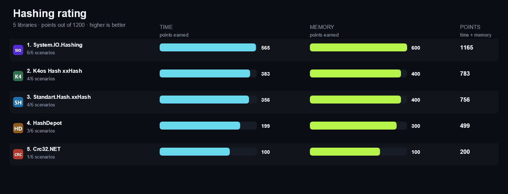](https://matrix.dev-team.org/?category=hashing)

| # | Library | Scenarios | Time | Memory | Points | Group wins |
|---:|---|---:|---:|---:|---:|---|
| 1 | [**System.IO.Hashing**](https://matrix.dev-team.org/?category=hashing&library=System.IO.Hashing) | 6/6 | 565 | 600 | 1165 | gold in Streaming, gold in Wide Hash, silver in Checksum, bronze in Hash, bronze in Large Input |
| 2 | [**K4os Hash xxHash**](https://matrix.dev-team.org/?category=hashing&library=K4os.Hash.xxHash) | 4/6 | 383 | 400 | 783 | silver in Hash, silver in Large Input, silver in Streaming, bronze in Checksum, bronze in Wide Hash |
| 3 | [**Standart.Hash.xxHash**](https://matrix.dev-team.org/?category=hashing&library=Standart.Hash.xxHash) | 4/6 | 356 | 400 | 756 | gold in Hash, gold in Large Input, silver in Wide Hash, bronze in Checksum, bronze in Streaming |
| 4 | [**HashDepot**](https://matrix.dev-team.org/?category=hashing&library=HashDepot) | 3/6 | 199 | 300 | 499 | bronze in Checksum, bronze in Streaming, bronze in Wide Hash |
| 5 | [**Crc32.NET**](https://matrix.dev-team.org/?category=hashing&library=Crc32.NET) | 1/6 | 100 | 100 | 200 | gold in Checksum, bronze in Streaming, bronze in Wide Hash |

<strong>How the points were earned</strong> — every scenario, with the measurements behind it

Each row is one scenario. `Best` is the lowest result among the rated libraries
that completed it, and the points follow from the two figures beside them:
`100 × √((best + step) / (result + step))`, with a step of 1 ns for time and 24 B
for memory. A dash means the library did not complete the scenario, and it scores
nothing for it. Add the two Points columns over every scenario and you get the
rating above. The same breakdown appears as a hint on any points value in the
[application](https://matrix.dev-team.org/?category=hashing).

#### 1. System.IO.Hashing — 1165 of 1200

| Scenario | Time | Best | Points | Memory | Best | Points |
|---|---:|---:|---:|---:|---:|---:|
| XxHash64 | 257.24 ns | 178.15 ns | 83.3 | 0 B | 0 B | 100 |
| XxHash32 | 363.24 ns | 352.06 ns | 98.5 | 0 B | 0 B | 100 |
| XxHash3 | 70.87 ns | 70.87 ns | 100 | 0 B | 0 B | 100 |
| XxHash64 Streaming | 327.06 ns | 327.06 ns | 100 | 96 B | 96 B | 100 |
| XxHash64 Large | 64.26 μs | 44.52 μs | 83.2 | 0 B | 0 B | 100 |
| Crc32 | 237.24 ns | 236.12 ns | 99.8 | 0 B | 0 B | 100 |

#### 2. K4os Hash xxHash — 783 of 1200

| Scenario | Time | Best | Points | Memory | Best | Points |
|---|---:|---:|---:|---:|---:|---:|
| XxHash64 | 203.86 ns | 178.15 ns | 93.5 | 0 B | 0 B | 100 |
| XxHash32 | 352.06 ns | 352.06 ns | 100 | 0 B | 0 B | 100 |
| XxHash3 | — | 70.87 ns | 0 | — | 0 B | 0 |
| XxHash64 Streaming | 351.1 ns | 327.06 ns | 96.5 | 96 B | 96 B | 100 |
| XxHash64 Large | 51.01 μs | 44.52 μs | 93.4 | 0 B | 0 B | 100 |
| Crc32 | — | 236.12 ns | 0 | — | 0 B | 0 |

#### 3. Standart.Hash.xxHash — 756 of 1200

| Scenario | Time | Best | Points | Memory | Best | Points |
|---|---:|---:|---:|---:|---:|---:|
| XxHash64 | 178.15 ns | 178.15 ns | 100 | 0 B | 0 B | 100 |
| XxHash32 | 352.71 ns | 352.06 ns | 99.9 | 0 B | 0 B | 100 |
| XxHash3 | 224.73 ns | 70.87 ns | 56.4 | 0 B | 0 B | 100 |
| XxHash64 Streaming | — | 327.06 ns | 0 | — | 96 B | 0 |
| XxHash64 Large | 44.52 μs | 44.52 μs | 100 | 0 B | 0 B | 100 |
| Crc32 | — | 236.12 ns | 0 | — | 0 B | 0 |

#### 4. HashDepot — 499 of 1200

| Scenario | Time | Best | Points | Memory | Best | Points |
|---|---:|---:|---:|---:|---:|---:|
| XxHash64 | 549.42 ns | 178.15 ns | 57.1 | 0 B | 0 B | 100 |
| XxHash32 | 480.97 ns | 352.06 ns | 85.6 | 0 B | 0 B | 100 |
| XxHash3 | — | 70.87 ns | 0 | — | 0 B | 0 |
| XxHash64 Streaming | — | 327.06 ns | 0 | — | 96 B | 0 |
| XxHash64 Large | 141.66 μs | 44.52 μs | 56.1 | 0 B | 0 B | 100 |
| Crc32 | — | 236.12 ns | 0 | — | 0 B | 0 |

#### 5. Crc32.NET — 200 of 1200

| Scenario | Time | Best | Points | Memory | Best | Points |
|---|---:|---:|---:|---:|---:|---:|
| XxHash64 | — | 178.15 ns | 0 | — | 0 B | 0 |
| XxHash32 | — | 352.06 ns | 0 | — | 0 B | 0 |
| XxHash3 | — | 70.87 ns | 0 | — | 0 B | 0 |
| XxHash64 Streaming | — | 327.06 ns | 0 | — | 96 B | 0 |
| XxHash64 Large | — | 44.52 μs | 0 | — | 0 B | 0 |
| Crc32 | 236.12 ns | 236.12 ns | 100 | 0 B | 0 B | 100 |

## Benchmark overview

**Hash**

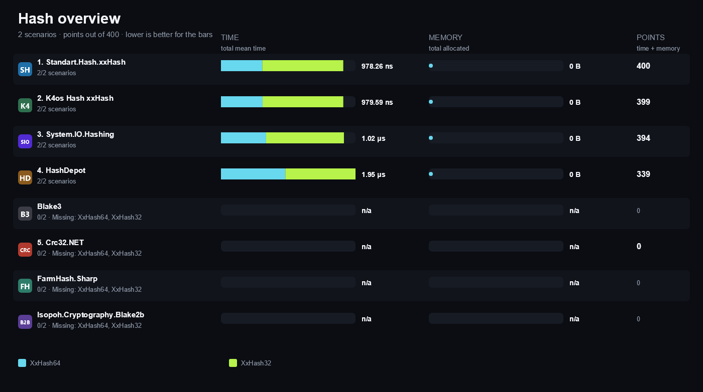

<strong>More overview charts (4)</strong>

#### Large Input

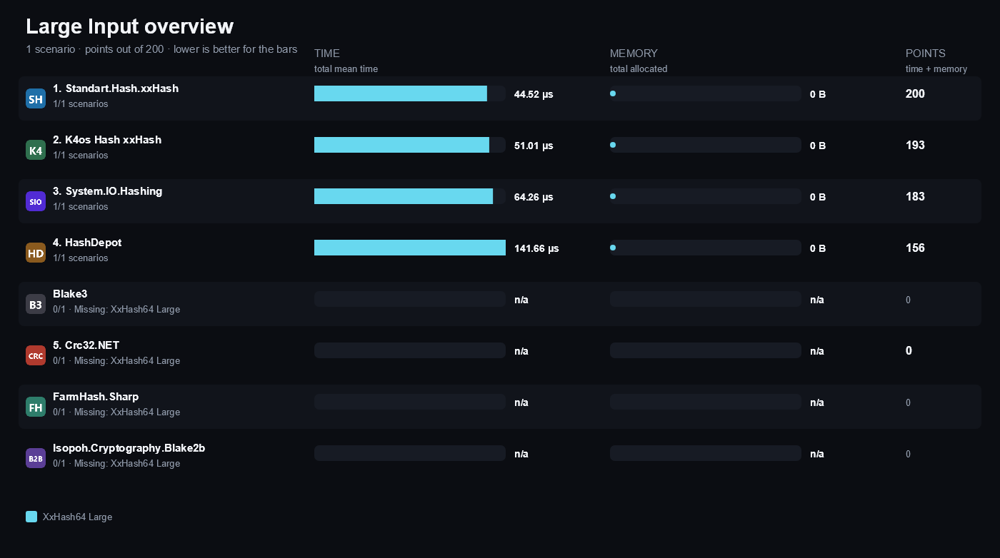

#### Streaming

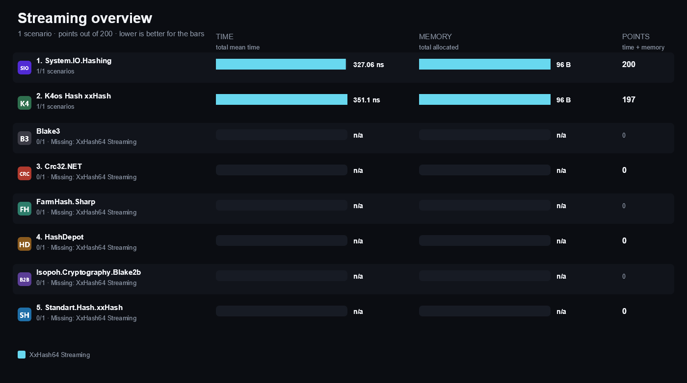

#### Checksum

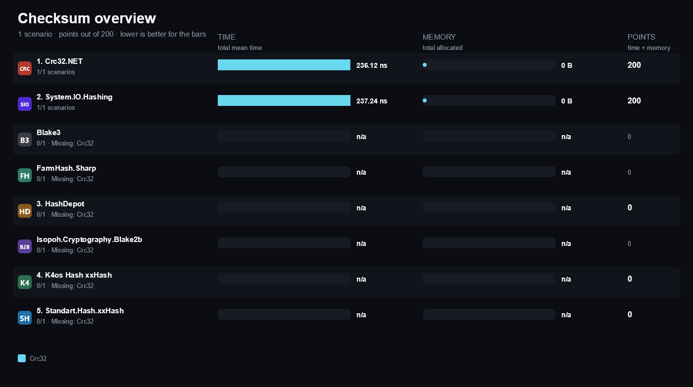

#### Wide Hash

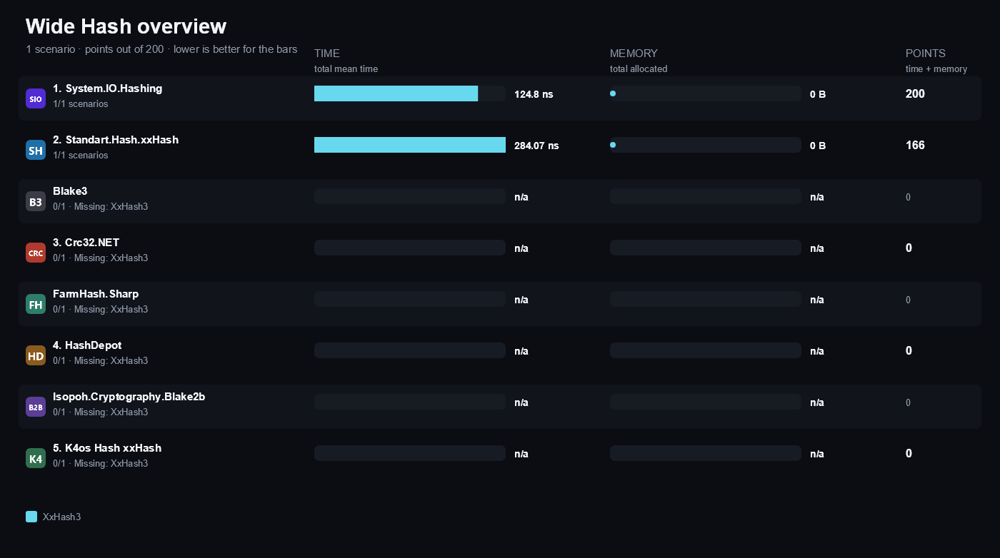

## Compared libraries (8)

<table>
<tr>
<td width="64"></td>
<td><strong><a href="https://github.com/xoofx/Blake3.NET">Blake3</a></strong> 3.0.2 A managed BLAKE3 implementation offering one-shot hashing and an incremental hasher.</td>
<td width="100" align="right"><a href="https://matrix.dev-team.org/?category=hashing&amp;library=Blake3">Compare →</a></td>
</tr>
<tr>
<td width="64"></td>
<td><strong><a href="https://github.com/force-net/Crc32.NET">Crc32.NET</a></strong> 2.1.0 A managed CRC-32 implementation with table, slicing-by-8, and hardware-accelerated backends.</td>
<td width="100" align="right"><a href="https://matrix.dev-team.org/?category=hashing&amp;library=Crc32.NET">Compare →</a></td>
</tr>
<tr>
<td width="64"></td>
<td><strong><a href="https://nickbabcock.github.io/Farmhash.Sharp/">FarmHash.Sharp</a></strong> 0.9.0 A managed port of Google FarmHash, exposing 32-bit and 64-bit fingerprints.</td>
<td width="100" align="right"><a href="https://matrix.dev-team.org/?category=hashing&amp;library=FarmHash.Sharp">Compare →</a></td>
</tr>
<tr>
<td width="64"></td>
<td><strong><a href="https://github.com/ssg/HashDepot">HashDepot</a></strong> 3.2.0 A collection of non-cryptographic hash functions including xxHash32, xxHash64, MurmurHash3, FNV-1a, and SipHash-2-4.</td>
<td width="100" align="right"><a href="https://matrix.dev-team.org/?category=hashing&amp;library=HashDepot">Compare →</a></td>
</tr>
<tr>
<td width="64"></td>
<td><strong><a href="https://github.com/mheyman/Isopoh.Cryptography.Argon2">Isopoh.Cryptography.Blake2b</a></strong> 2.0.0 A managed BLAKE2b implementation with keyed, salted, and configurable digest lengths.</td>
<td width="100" align="right"><a href="https://matrix.dev-team.org/?category=hashing&amp;library=Isopoh.Cryptography.Blake2b">Compare →</a></td>
</tr>
<tr>
<td width="64"></td>
<td><strong><a href="https://github.com/MiloszKrajewski/K4os.Hash.xxHash">K4os Hash xxHash</a></strong> 1.0.8 A managed xxHash implementation with one-shot and incremental XxHash32 and XxHash64 APIs.</td>
<td width="100" align="right"><a href="https://matrix.dev-team.org/?category=hashing&amp;library=K4os.Hash.xxHash">Compare →</a></td>
</tr>
<tr>
<td width="64"></td>
<td><strong><a href="https://github.com/uranium62/xxHash">Standart.Hash.xxHash</a></strong> 4.0.5 A focused xxHash library exposing seeded one-shot XxHash32, XxHash64, XxHash3, and XxHash128 functions plus stream overloads.</td>
<td width="100" align="right"><a href="https://matrix.dev-team.org/?category=hashing&amp;library=Standart.Hash.xxHash">Compare →</a></td>
</tr>
<tr>
<td width="64"></td>
<td><strong><a href="https://learn.microsoft.com/dotnet/api/system.io.hashing">System.IO.Hashing</a></strong> 10.0.14 The non-cryptographic hash algorithms shipped with .NET: XxHash32, XxHash64, XxHash3, CRC32, and CRC64.</td>
<td width="100" align="right"><a href="https://matrix.dev-team.org/?category=hashing&amp;library=System.IO.Hashing">Compare →</a></td>
</tr>
</table>

## Benchmark scenarios (9)

### 01 · XxHash64

Hashes a 4 KiB buffer with one call to the library xxHash64 function.

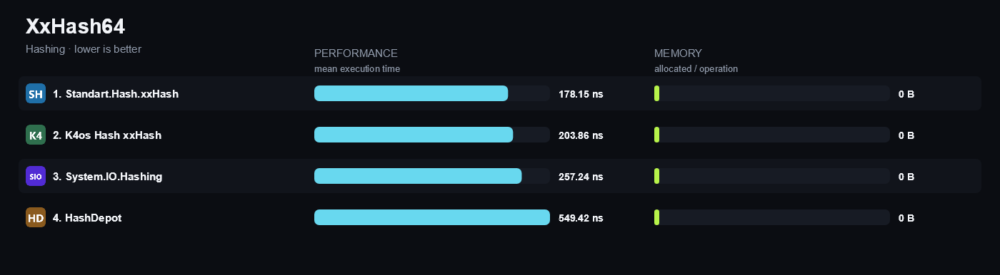

### 02 · XxHash32

Hashes a 4 KiB buffer with one call to the library xxHash32 function.

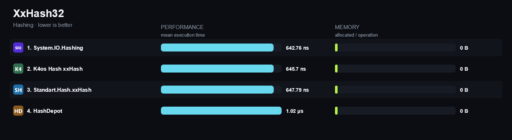

### 03 · XxHash3

Hashes a 4 KiB buffer with one call to the library xxHash3 function, sixty-four bits wide.

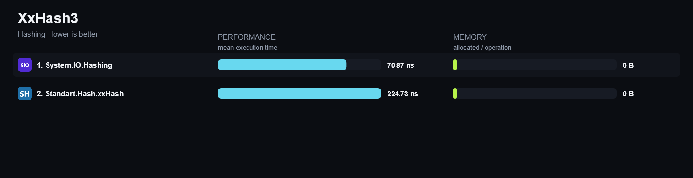

### 04 · XxHash64 Streaming

Hashes a 4 KiB buffer as sixty-four incremental updates of sixty-four bytes each.

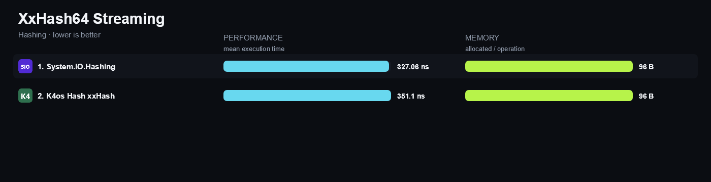

### 05 · XxHash64 Large

Hashes a 1 MiB buffer with one call to the library xxHash64 function, where throughput rather than call overhead dominates.

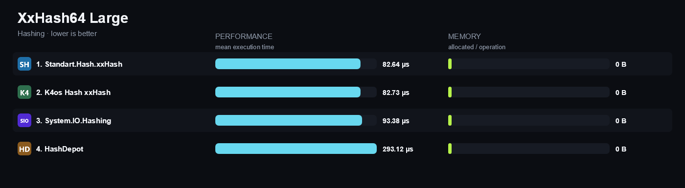

### 06 · Crc32

Computes the CRC-32 (IEEE) checksum of a 4 KiB buffer with one call.

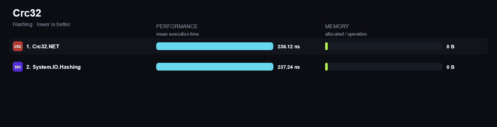

### 07 · Blake3

Hashes a 4 KiB buffer with BLAKE3 and returns the eight leading digest bytes.

*Not rated: With this few rated entrants, the reference is a library's own result, not a result earned against a competitor, so the full 200 points would not reflect a win. (0 of 5 rated libraries support this.)*

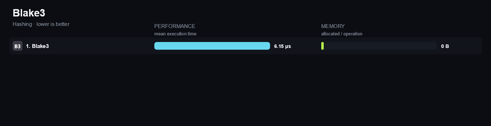

### 08 · Blake2b

Hashes a 4 KiB buffer with BLAKE2b at a 32-byte digest and returns the eight leading digest bytes.

*Not rated: With this few rated entrants, the reference is a library's own result, not a result earned against a competitor, so the full 200 points would not reflect a win. (0 of 5 rated libraries support this.)*

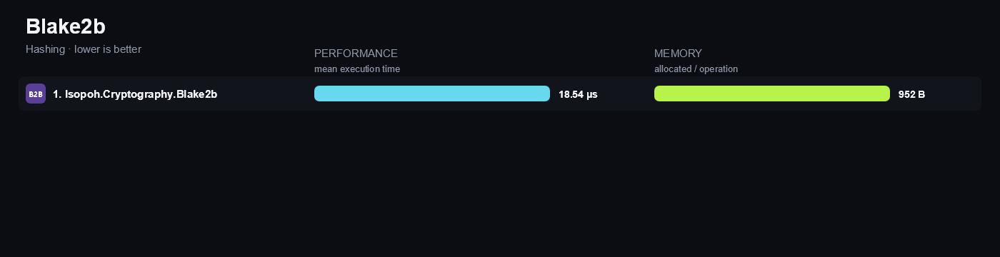

### 09 · FarmHash64

Hashes a 4 KiB buffer with one call to the library FarmHash64 function.

*Not rated: With this few rated entrants, the reference is a library's own result, not a result earned against a competitor, so the full 200 points would not reflect a win. (0 of 5 rated libraries support this.)*

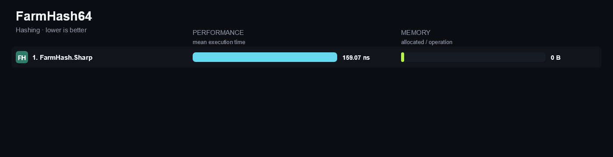

