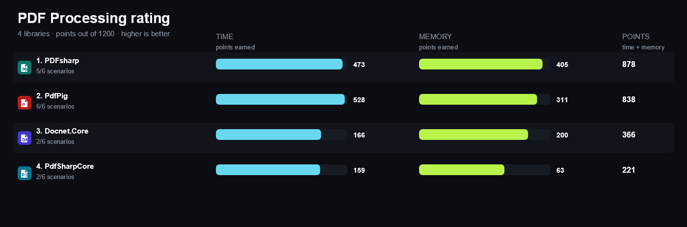
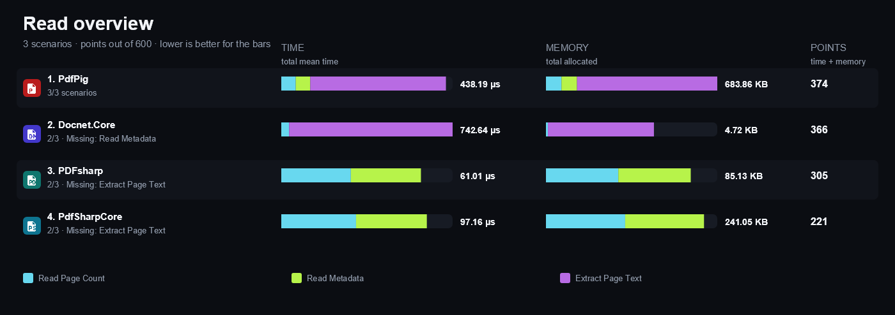
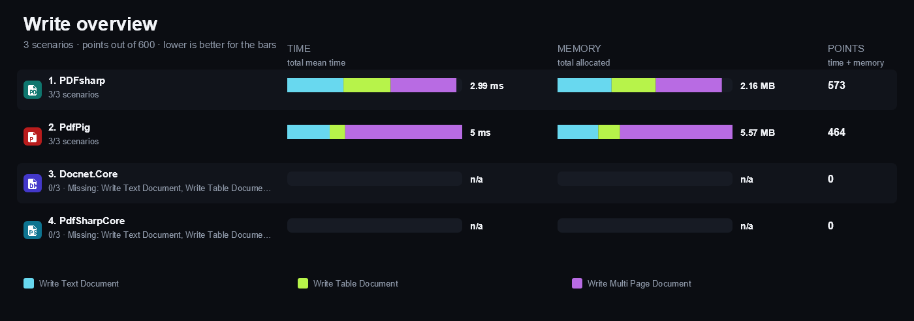
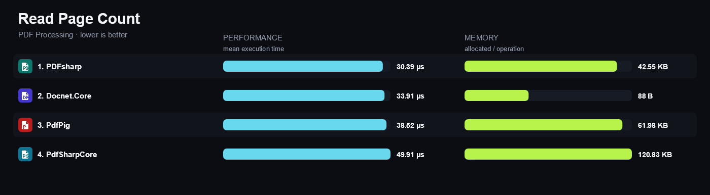
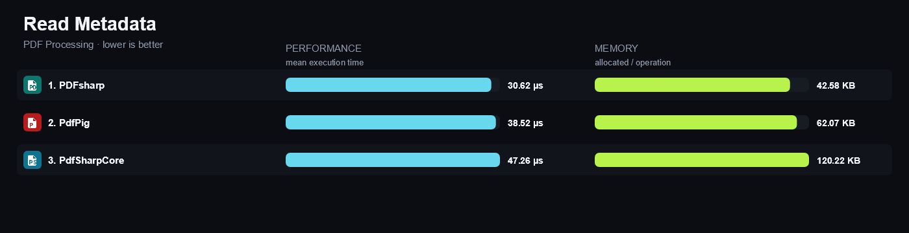
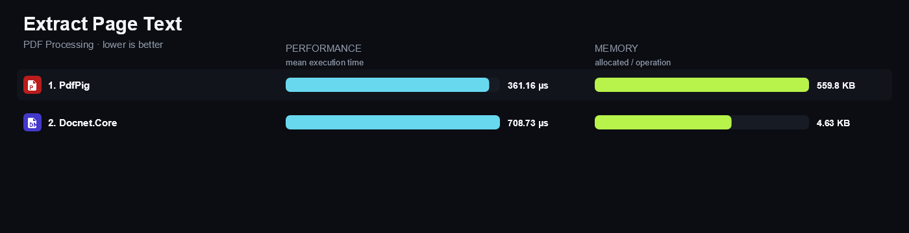
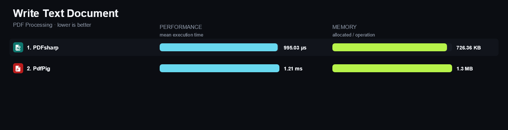
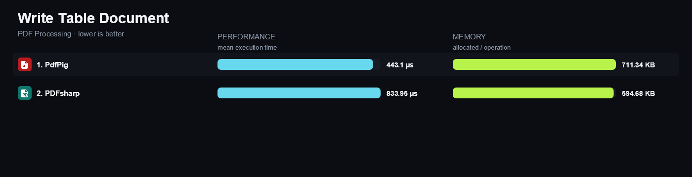
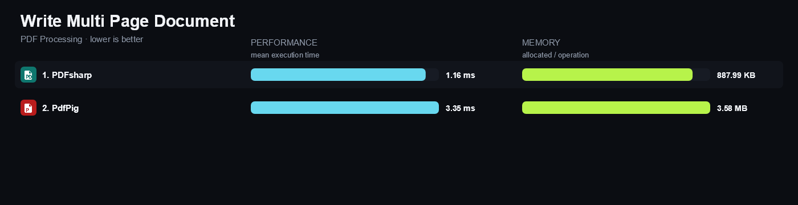

<!-- Generated by build/Templates/CategoryReport.cshtml. Do not edit this file directly. -->

[← .NET Matrix](../../README.md) · [Open the interactive matrix →](https://matrix.dev-team.org/?category=pdf-processing)

# PDF Processing

<blockquote>
<strong><a href="https://matrix.dev-team.org/?category=pdf-processing&amp;library=PDFsharp">PDFsharp</a></strong> leads the current rating · 4 libraries · 6 scenarios
</blockquote>

## Rating

In every scenario the fastest library scores 100 points and the one allocating
least scores 100 more; four times slower is half the points, and an unsupported
scenario is worth nothing. Time and memory reach **600**
each here, so the maximum is **1200**.
See [workflows/rating.md](../../workflows/rating.md).

| # | Library | Scenarios | Time | Memory | Points | Group wins |
|---:|---|---:|---:|---:|---:|---|
| 1 | [**PDFsharp**](https://matrix.dev-team.org/?category=pdf-processing&library=PDFsharp) | 5/6 | 473 | 405 | 878 | gold in Write, bronze in Read |
| 2 | [**PdfPig**](https://matrix.dev-team.org/?category=pdf-processing&library=PdfPig) | 6/6 | 528 | 311 | 838 | gold in Read, silver in Write |
| 3 | [**Docnet.Core**](https://matrix.dev-team.org/?category=pdf-processing&library=Docnet.Core) | 2/6 | 166 | 200 | 366 | silver in Read, bronze in Write |
| 4 | [**PdfSharpCore**](https://matrix.dev-team.org/?category=pdf-processing&library=PdfSharpCore) | 2/6 | 159 | 63 | 221 | bronze in Write |

<strong>How the points were earned</strong> — every scenario, with the measurements behind it

Each row is one scenario. `Best` is the lowest result among the rated libraries
that completed it, and the points follow from the two figures beside them:
`100 × √((best + step) / (result + step))`, with a step of 1 ns for time and 24 B
for memory. A dash means the library did not complete the scenario, and it scores
nothing for it. Add the two Points columns over every scenario and you get the
rating above. The same breakdown appears as a hint on any points value in the
[application](https://matrix.dev-team.org/?category=pdf-processing).

#### 1. PDFsharp — 878 of 1200

| Scenario | Time | Best | Points | Memory | Best | Points |
|---|---:|---:|---:|---:|---:|---:|
| Read Page Count | 30.39 μs | 30.39 μs | 100 | 42.55 KB | 88 B | 5.069 |
| Read Metadata | 30.62 μs | 30.62 μs | 100 | 42.58 KB | 42.58 KB | 100 |
| Extract Page Text | — | 361.16 μs | 0 | — | 4.63 KB | 0 |
| Write Text Document | 995.03 μs | 995.03 μs | 100 | 726.36 KB | 726.36 KB | 100 |
| Write Table Document | 833.95 μs | 443.1 μs | 72.9 | 594.68 KB | 594.68 KB | 100 |
| Write Multi Page Document | 1.16 ms | 1.16 ms | 100 | 887.99 KB | 887.99 KB | 100 |

#### 2. PdfPig — 838 of 1200

| Scenario | Time | Best | Points | Memory | Best | Points |
|---|---:|---:|---:|---:|---:|---:|
| Read Page Count | 38.52 μs | 30.39 μs | 88.8 | 61.98 KB | 88 B | 4.2 |
| Read Metadata | 38.52 μs | 30.62 μs | 89.2 | 62.07 KB | 42.58 KB | 82.8 |
| Extract Page Text | 361.16 μs | 361.16 μs | 100 | 559.8 KB | 4.63 KB | 9.12 |
| Write Text Document | 1.21 ms | 995.03 μs | 90.6 | 1.3 MB | 726.36 KB | 74 |
| Write Table Document | 443.1 μs | 443.1 μs | 100 | 711.34 KB | 594.68 KB | 91.4 |
| Write Multi Page Document | 3.35 ms | 1.16 ms | 59 | 3.58 MB | 887.99 KB | 49.2 |

#### 3. Docnet.Core — 366 of 1200

| Scenario | Time | Best | Points | Memory | Best | Points |
|---|---:|---:|---:|---:|---:|---:|
| Read Page Count | 33.91 μs | 30.39 μs | 94.7 | 88 B | 88 B | 100 |
| Read Metadata | — | 30.62 μs | 0 | — | 42.58 KB | 0 |
| Extract Page Text | 708.73 μs | 361.16 μs | 71.4 | 4.63 KB | 4.63 KB | 100 |
| Write Text Document | — | 995.03 μs | 0 | — | 726.36 KB | 0 |
| Write Table Document | — | 443.1 μs | 0 | — | 594.68 KB | 0 |
| Write Multi Page Document | — | 1.16 ms | 0 | — | 887.99 KB | 0 |

#### 4. PdfSharpCore — 221 of 1200

| Scenario | Time | Best | Points | Memory | Best | Points |
|---|---:|---:|---:|---:|---:|---:|
| Read Page Count | 49.91 μs | 30.39 μs | 78 | 120.83 KB | 88 B | 3.008 |
| Read Metadata | 47.26 μs | 30.62 μs | 80.5 | 120.22 KB | 42.58 KB | 59.5 |
| Extract Page Text | — | 361.16 μs | 0 | — | 4.63 KB | 0 |
| Write Text Document | — | 995.03 μs | 0 | — | 726.36 KB | 0 |
| Write Table Document | — | 443.1 μs | 0 | — | 594.68 KB | 0 |
| Write Multi Page Document | — | 1.16 ms | 0 | — | 887.99 KB | 0 |

## Benchmark overview

**Read**

<strong>More overview charts (1)</strong>

#### Write

## Compared libraries (4)

<table>
<tr>
<td width="64"></td>
<td><strong><a href="https://github.com/GowenGit/docnet">Docnet.Core</a></strong> 2.6.0 A binding of the PDFium engine that reads page counts, text and rendered images.</td>
<td width="100" align="right"><a href="https://matrix.dev-team.org/?category=pdf-processing&amp;library=Docnet.Core">Compare →</a></td>
</tr>
<tr>
<td width="64"></td>
<td><strong><a href="https://github.com/UglyToad/PdfPig">PdfPig</a></strong> 0.1.16 A managed PDF reader that exposes pages, letters and words as parsed objects.</td>
<td width="100" align="right"><a href="https://matrix.dev-team.org/?category=pdf-processing&amp;library=PdfPig">Compare →</a></td>
</tr>
<tr>
<td width="64"></td>
<td><strong><a href="https://docs.pdfsharp.net">PDFsharp</a></strong> 6.5.0 A PDF document library with drawing, page and outline support for reading and writing.</td>
<td width="100" align="right"><a href="https://matrix.dev-team.org/?category=pdf-processing&amp;library=PDFsharp">Compare →</a></td>
</tr>
<tr>
<td width="64"></td>
<td><strong><a href="https://github.com/ststeiger/PdfSharpCore">PdfSharpCore</a></strong> 1.3.67 A cross-platform fork of PDFsharp 1.x for reading and drawing PDF documents.</td>
<td width="100" align="right"><a href="https://matrix.dev-team.org/?category=pdf-processing&amp;library=PdfSharpCore">Compare →</a></td>
</tr>
</table>

## Benchmark scenarios (6)

### 01 · Read Page Count

Opens the three-page fixture and reports the page count, with no page content extracted.

### 02 · Read Metadata

Opens the fixture and reads the document title and author from the information dictionary.

### 03 · Extract Page Text

Opens the fixture and extracts the text of the first page, including content stream decoding.

### 04 · Write Text Document

Produces a one-page document with a heading and twenty body lines, and saves it to a byte array.

### 05 · Write Table Document

Produces a one-page document holding a thirty-row, three-column table with a header row, and saves it to a byte array.

### 06 · Write Multi Page Document

Produces a four-page document whose pages each carry a heading and twelve lines, and saves it to a byte array.

